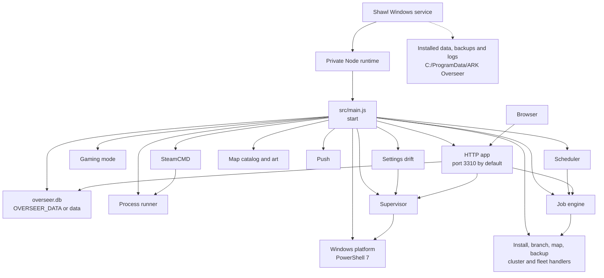
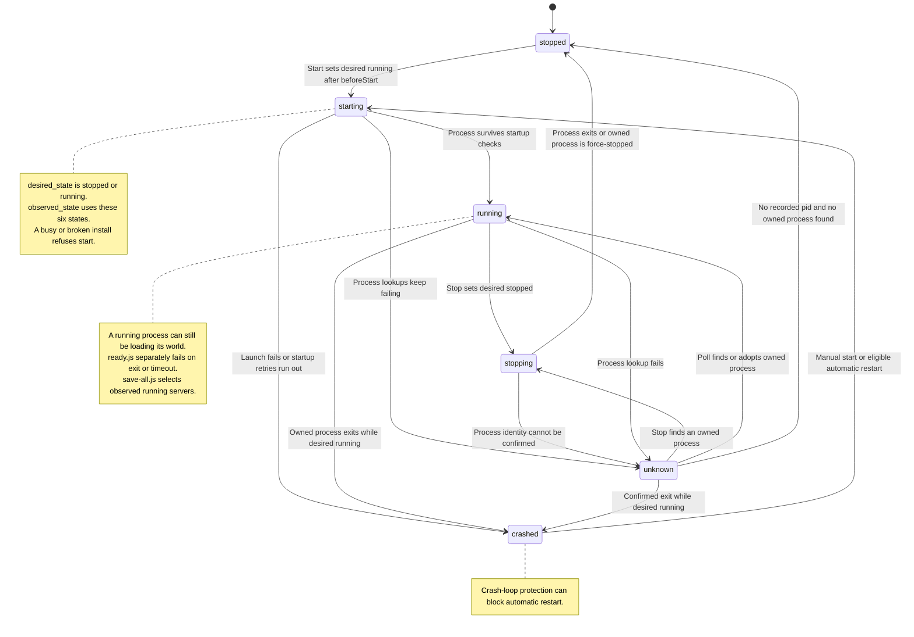
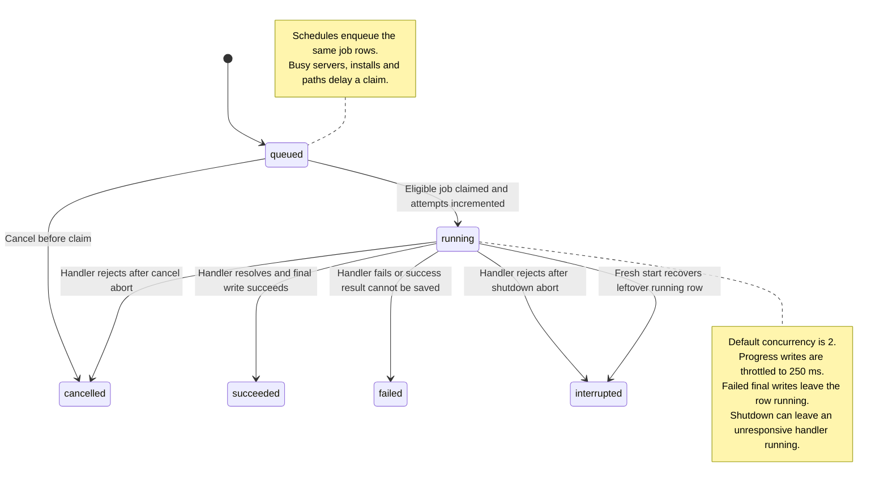
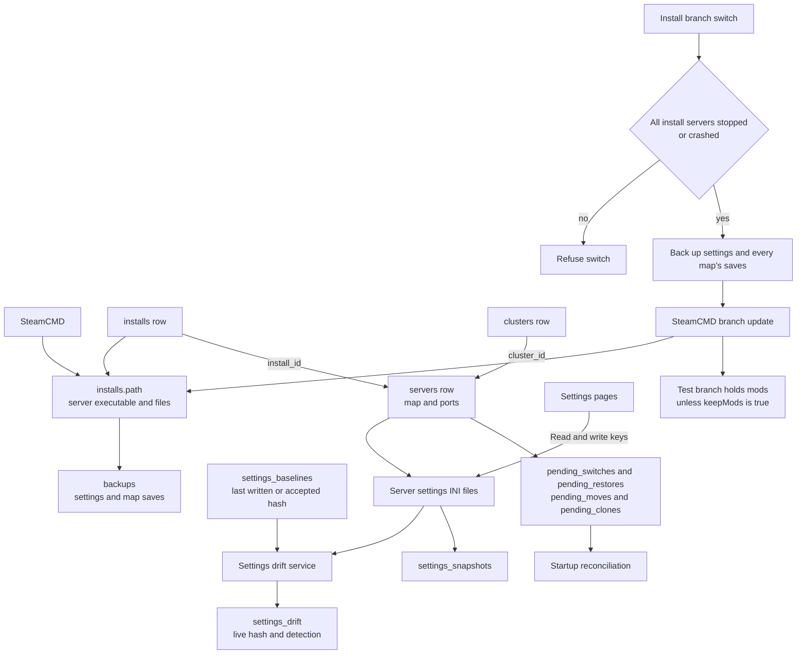
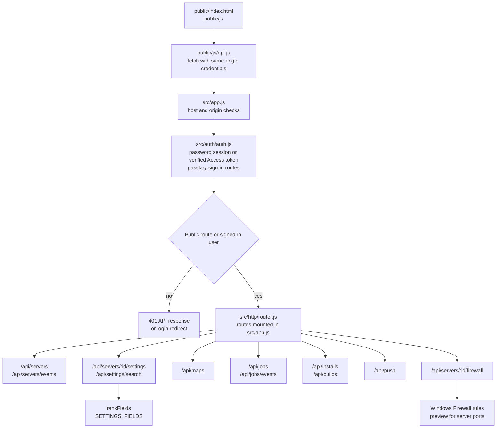

# ARK Overseer

ARK Overseer is a web app for running ARK: Survival Ascended dedicated servers on a Windows PC. It installs and updates servers through SteamCMD, runs several side by side, and keeps their settings, ports, backups and schedules in one place. You open it in a browser on the same PC, or from a phone or another computer on your network.

Each server has its own overview with Start, Stop and Restart, a settings page for every documented option (searchable by meaning, so "make dinos grow up faster" finds Baby Mature Speed Multiplier), and a network page that lists the ports and the Windows Firewall rules they need. You can switch a server to another map, keep named settings snapshots, take and restore backups, and clone, move, remove or bulk-manage servers. Clusters let players carry survivors and creatures between servers. Restarts, backups and updates run on a schedule and warn players in game first.



*Source of truth: `src/main.js`, `tools/service.ps1`, and the README. The first password must be set on the host PC before Cloudflare Access sign-in works.*



*Source of truth: `src/db/migrations.js`, `src/supervisor/supervisor.js`, and `src/main.js`. RCON reads `ServerAdminPassword` from `GameUserSettings.ini`.*



*Source of truth: `src/jobs/engine.js`, `src/db/migrations.js`, and `src/scheduler/scheduler.js`. `GET /api/jobs` and `GET /api/jobs/events` expose rows and the event stream.*



*Source of truth: `src/db/migrations.js`, `src/builds/branch.js`, and `src/backups/restore.js`. A branch switch needs every server stopped first.*



*Source of truth: `public/js/api.js`, `src/app.js`, `src/http/router.js`, and `src/auth/auth.js`. Public files and the auth endpoints skip the signed-in gate.*

## Install

You need Windows 10 or 11, 64-bit. Nothing else has to be installed first.

1. Download the newest `ark-overseer-<version>-win-x64.zip` from the [releases page](https://github.com/neostryder/ark-overseer/releases).
2. Unpack it anywhere and double-click **Install ARK Overseer**. Windows may warn that the file comes from an unknown publisher, because the installer isn't code-signed. Choose More info, then Run anyway. Windows then asks for administrator approval once.
3. On the same PC, open http://localhost:3310 and set a password. The first password can only be set from the PC that runs ARK Overseer.
4. The setup wizard walks you through creating your first server, or importing one you already run.

ARK Overseer runs as a Windows service, so it starts with Windows and keeps running when nobody is signed in. It brings its own copy of Node and PowerShell 7. Its database, backups and logs live in `C:\ProgramData\ARK Overseer`, and you can delete the unpacked folder after the install finishes.

To remove it, double-click **Uninstall ARK Overseer**. It asks before it touches your data.

## Updating

Open ARK Overseer on the PC that runs it, go to **This computer** and choose Update. Windows asks for administrator approval, the service installs the new version and restarts, and the page reloads when it's back. Pick the Stable, Beta or Edge channel, read the release notes before you update, and go back to an earlier release if a new one causes trouble. If an update fails, the previous version is put back.

## Reaching it from other devices

Other devices on your network can open `http://<the PC's name>:3310`, but Windows Firewall blocks them until you allow the port. In an administrator PowerShell:

```powershell
netsh advfirewall firewall add rule name="ARK Overseer" dir=in action=allow protocol=TCP localport=3310 profile=private
```

Sign in with the same password. Passkeys work on the PC itself, and on other devices only over HTTPS.

## Test branches

ARK Overseer can run servers on a Steam test branch such as the Public Test Realm, which gets new server builds before the live game. The Steam branch and builds card on a server's Overview page moves an install to a test branch and back, and Add a test copy puts a copy of a server in its own folder on the test branch while the original stays on the live game. A switch needs the install's servers stopped, and ARK Overseer backs up the settings and every map's saves before it downloads anything. On a test branch the server's mods go on hold and a clustered server stays put unless you tick the box to override either one. Worlds saved by a test build may not load on the live game, so the way back is restoring the backup taken before the switch from the Backups page.

## Adding detail to crash alerts

If you want a crash alert to say more, point Overseer at a program of your own. Make a file called `crash-hook.json` in the data folder (`C:\ProgramData\ARK Overseer` when it runs as the service) that names the program and what to pass it:

```json
{
  "command": "C:\\Python\\python.exe",
  "args": ["C:\\Tools\\triage.py", "{logPath}", "{serverName}"],
  "timeoutSeconds": 45
}
```

Right before a crash alert goes out, Overseer runs the program once and tacks the first line it prints onto the alert. In `args` you can use `{serverId}`, `{serverName}`, `{reason}`, `{logPath}` and `{installPath}`. Each one arrives as a single argument, so a server name with spaces is fine. The command has to be the full path of an executable (a `.bat` or `.cmd` file won't work, so run the interpreter and hand it your script). It's stopped after `timeoutSeconds`, which defaults to 45 and tops out at 120. If it fails, runs out of time, or the file is malformed, the problem goes in the log and the alert is sent without the extra line.

Overseer rereads the file on every crash, so you can edit it without a restart. Only someone at the PC can change it; the web interface has no setting for it.

## Behind Cloudflare Access

If you publish ARK Overseer on a domain protected by Cloudflare Access, enter your Access team domain, the application's AUD tag and the public address on the This computer page. A request that carries a valid Access token then signs in without the password prompt. Every token is checked again on every request, and the site and address checks still apply. The first password is still set on the PC itself.

## Running from source

You need Node.js 26 or later, PowerShell 7 and Git. Run `npm install`, then `npm start`, and open http://localhost:3310 on the same computer. The database, backups and SteamCMD live in the `data` folder next to the code. Set `OVERSEER_DATA` to keep them somewhere else, or `OVERSEER_PORT` to use another port.

Run the tests with `npm test`, check formatting with `npm run format:check`, and check the settings catalog with `npm run check`. `node tools/build-release.js` builds the release zip, and `tools\service.ps1 install` installs a checkout as the service.

## Contributing

Bug reports and feature requests are welcome as issues. Pull requests need a signed contributor agreement first; see [CONTRIBUTING.md](CONTRIBUTING.md).

## License

ARK Overseer is free software under the GNU Affero General Public License, version 3 (AGPL-3.0). The full text is in [LICENSE](LICENSE). You can use it, change it and share it at no cost, for your own servers or anyone else's. If you change it and let other people use your changed version over a network, such as a hosting panel your customers sign in to, the AGPL requires you to offer those people your changed source code.

Commercial licenses are also available for anyone who wants to run a changed version without publishing the changes, such as a game hosting company building ARK Overseer into its own panel. To ask about one, contact neostryder on GitHub. Every release zip includes a `THIRD_PARTY_NOTICES.md` file with the licenses of the software bundled in it.
